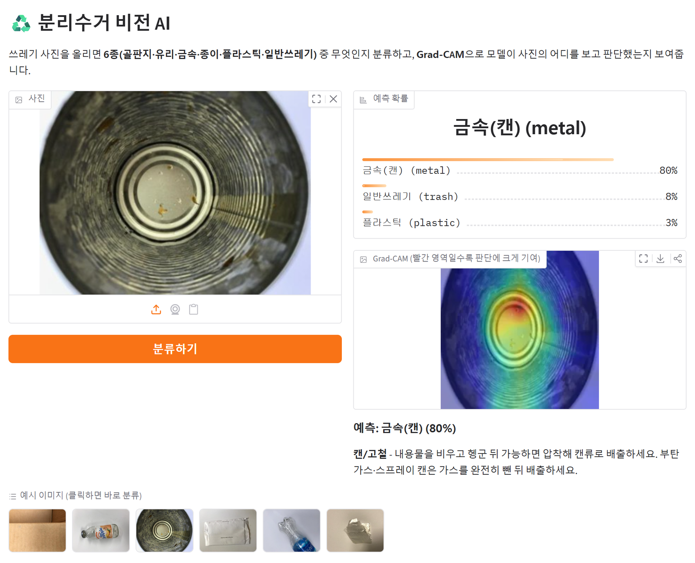
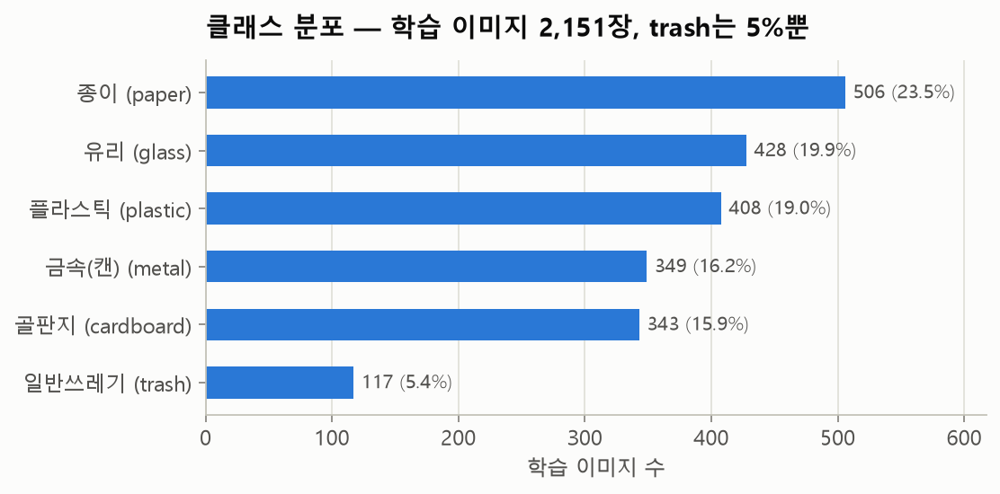
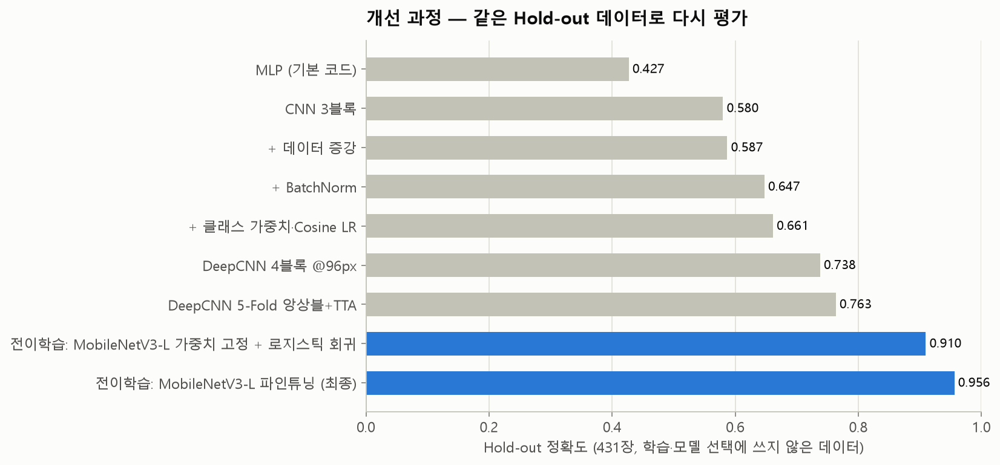
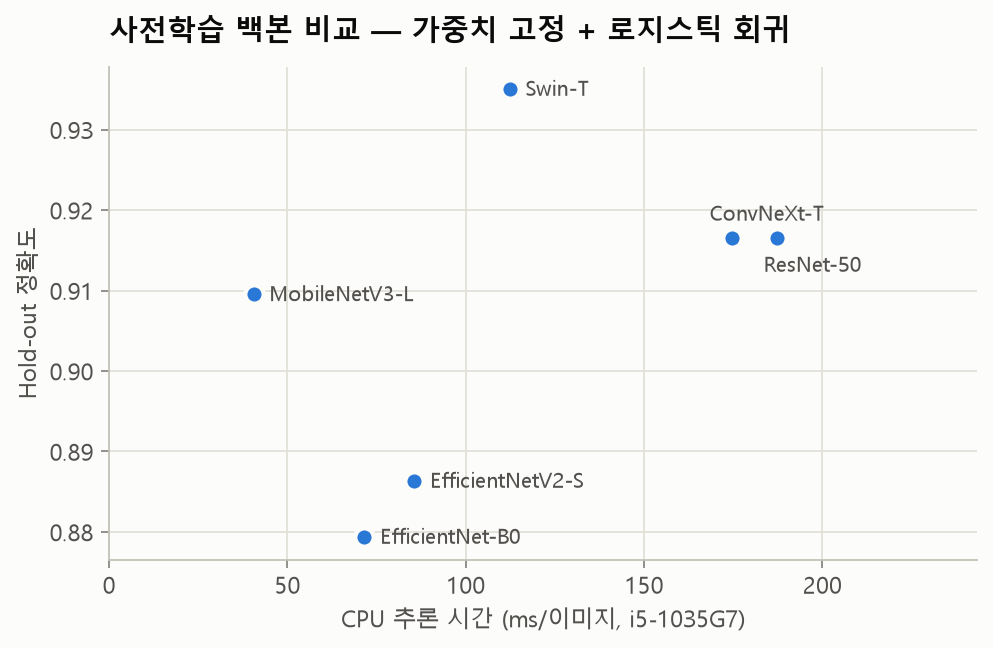
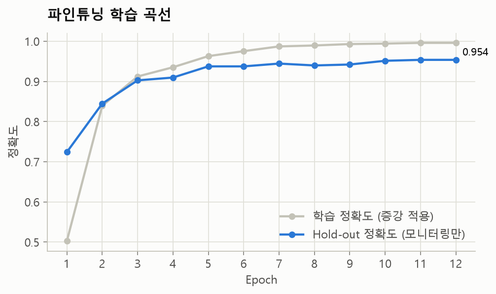
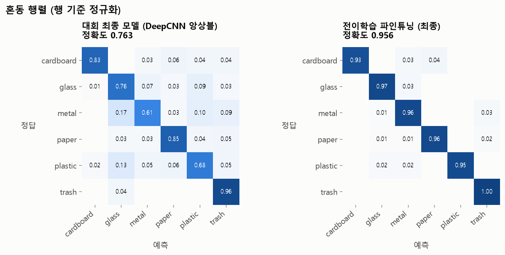
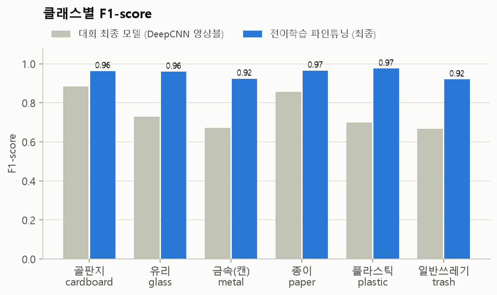
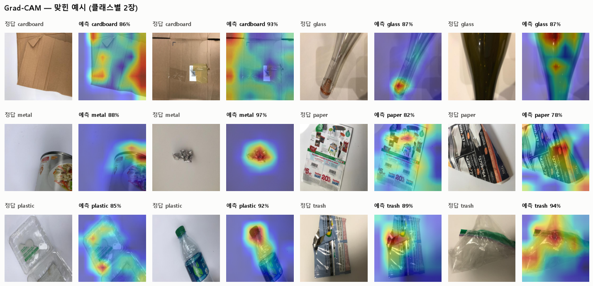
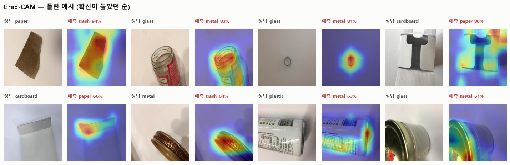

<div align="center">

# ♻️ 분리수거 비전 AI

**재활용품 사진 한 장으로 6종(골판지·유리·금속·종이·플라스틱·일반쓰레기)을 분류하는 이미지 분류 모델**


2026 청년 AI 머신러닝/딥러닝 과정 · 분리수거 AI 챌린지(Kaggle) **6위** 출전작을, 대회 이후 다시 설계해 발전시킨 프로젝트입니다.

</div>

| | 대회 당시 (2026.09) | 대회 이후 개선 |
|---|---|---|
| 모델 | 직접 설계한 4블록 CNN · 5-Fold 앙상블 | ImageNet 사전학습 **MobileNetV3-Large 파인튜닝** |
| Hold-out 정확도* | 0.763 | **0.956** (+19.3%p) |
| Macro F1* | 0.751 | **0.951** (+20.0%p) |
| `trash` F1 (가장 어려운 클래스) | 0.667 | **0.920** |
| CPU 추론 시간 | – | **약 40ms / 이미지** |
| Kaggle Public | 0.75000 (6위) | – (대회 종료) |

<sub>* 같은 Hold-out 431장(학습·모델 선택에 쓰지 않은 데이터)으로 두 모델을 모두 다시 평가한 수치입니다. → [평가 방법](#3-대회-이후-공정한-평가-기준부터-다시)</sub>

<p align="center"></p>

---

## 목차
1. [문제와 데이터](#1-문제와-데이터)
2. [대회 당시: 바닥부터 만든 CNN으로 0.54 → 0.75](#2-대회-당시-바닥부터-만든-cnn으로-054--075)
3. [대회 이후: 공정한 평가 기준부터 다시](#3-대회-이후-공정한-평가-기준부터-다시)
4. [전이학습: 어떤 백본이 좋을까?](#4-전이학습-어떤-백본이-좋을까)
5. [최종 모델: MobileNetV3-Large 파인튜닝](#5-최종-모델-mobilenetv3-large-파인튜닝)
6. [오류 분석 & Grad-CAM](#6-오류-분석--grad-cam)
7. [데모 실행](#7-데모-실행)
8. [재현 방법](#8-재현-방법)
9. [프로젝트 구조](#9-프로젝트-구조)
10. [배운 점과 한계](#10-배운-점과-한계)

---

## 1. 문제와 데이터

분리배출을 잘못하면 재활용 선별장에서 다시 손으로 골라내야 합니다. 사진만으로 재질을 자동 분류할 수 있으면 스마트 분리수거함이나 분리배출 안내 앱의 핵심 기능이 됩니다.

- **데이터**: [TrashNet](https://github.com/garythung/trashnet) 기반 대회 데이터. 학습 2,151장, 테스트 373장(정답 비공개). 512×384 RGB, 흰 배경에서 촬영
- **클래스**: `cardboard` · `glass` · `metal` · `paper` · `plastic` · `trash`
- **평가지표**: 정확도(Accuracy)

<p align="center"></p>

`trash`가 전체의 5%(117장)뿐인 **클래스 불균형**과, 표면 질감으로만 구분되는 **유리↔플라스틱**, **종이↔골판지**가 핵심 난제였습니다.

## 2. 대회 당시: 바닥부터 만든 CNN으로 0.54 → 0.75

팀 **GangNPArk**(강인수·박지훈)으로 출전해, 한 번에 하나씩만 바꾸며 효과를 확인하는 방식으로 모델을 개선했습니다.

| # | 바꾼 것 | Kaggle Public |
|---|---|---|
| 0 | 기본 코드 (MLP) | 0.5373 |
| 1 | MLP → CNN 3블록 | 0.6607 |
| 2 | + 데이터 증강 (좌우반전, 회전 15°) | 0.6875 |
| 3 | + BatchNorm | 0.7500 |
| 4 | + 클래스 가중치 + Cosine LR | 0.7500 |
| 6 | DeepCNN 4블록 @96px + **5-Fold 앙상블 + TTA** | **0.7500 (최종 6위)** |

대회 당시 원본 코드는 [`legacy/`](legacy/)에 그대로 보관했습니다.

**대회 중 겪은 문제.** 검증 데이터가 85/15로 한 번 나눈 322장뿐이라, 실행할 때마다 검증 정확도가 크게 흔들렸습니다. 그래서 어떤 변경이 진짜 효과가 있었는지 판단하기 어려웠습니다. 예를 들어 데이터 증강은 검증 정확도로는 −8.4%p였지만 Public 점수는 올랐습니다.

## 3. 대회 이후: 공정한 평가 기준부터 다시

모델을 바꾸기 전에 **평가 기준부터 고정**했습니다.

- 학습 데이터 2,151장을 클래스 비율대로 **Dev 1,720장 / Hold-out 431장**으로 한 번만 나누고(seed 42, [`results/split.json`](results/split.json)), Hold-out은 **학습·하이퍼파라미터 튜닝·모델 선택에 전혀 쓰지 않았습니다.**
- 대회 당시의 0~6단계 모델을 모두 같은 조건으로 다시 학습해 같은 Hold-out에서 평가했습니다([`experiments/01_baselines.py`](experiments/01_baselines.py)).
- 백본 선택은 Dev 안의 5-Fold 교차검증 점수로만 했고, 파인튜닝 epoch 수는 미리 고정했습니다. Hold-out 점수는 학습 곡선에서 지켜보기만 했고, 백본·epoch·하이퍼파라미터 결정에는 쓰지 않았습니다.

<p align="center"></p>

- **대회 당시의 판단은 대부분 맞았습니다.** 같은 기준으로 다시 재도 0.427 → 0.763으로 단계마다 올랐습니다. 특히 보고서에서 추측했던 "증강은 BatchNorm이 있어야 효과가 난다"는 그대로 확인됐습니다. 증강만 추가하면 +0.7%p였지만, BatchNorm을 함께 넣으면 +6.0%p였습니다.
- **Public 점수로는 보이지 않던 차이가 보입니다.** 3·4·6단계는 Public 점수가 모두 0.7500으로 같았지만, Hold-out에서는 0.647 / 0.661 / 0.763으로 분명히 달랐습니다.
- 0~2단계 모델은 `trash`를 **한 장도 예측하지 못했습니다**(F1 0.000). 117장뿐인 클래스를 무시해도 정확도가 크게 떨어지지 않기 때문에, 정확도만 보면 놓치기 쉬운 문제였습니다.
- **전이학습은 한 번에 그 이상을 해냈습니다.** 가중치를 고정한 MobileNetV3 특징에 로지스틱 회귀만 붙여도 0.910으로, 대회 기간 내내 구조를 다듬은 최종 모델(0.763)보다 14.7%p 높았습니다.

<sub>Hold-out 수치와 Public 점수는 평가 데이터가 달라서 직접 비교할 수 없습니다. 0~5단계는 대회 방식 그대로 Dev의 15%로 best epoch를 골랐고, 6단계는 Dev 안에서 5-Fold로 학습했습니다.</sub>

## 4. 전이학습: 어떤 백본이 좋을까?

바닥부터 학습한 CNN은 2천 장 남짓한 데이터로는 재질의 미세한 질감을 배우기 어렵습니다. 그래서 ImageNet(120만 장)으로 사전학습한 모델의 표현을 가져오기로 했습니다.

GPU가 없는 노트북(i5-1035G7)에서 작업했기 때문에, 모든 후보를 파인튜닝해 보는 대신 **가중치를 고정한 특징 추출 + 로지스틱 회귀**로 6개 백본을 빠르고 공정하게 비교했습니다([`experiments/02_backbone_probe.py`](experiments/02_backbone_probe.py)).

<p align="center"></p>

| 백본 | 특징 차원 | Dev 5-Fold CV 정확도 | Hold-out 정확도 | Hold-out Macro-F1 | CPU 추론 (ms) |
|---|---:|---:|---:|---:|---:|
| ConvNeXt-Tiny | 768 | 0.913 | 0.916 | 0.906 | 175 |
| Swin-Tiny | 768 | 0.910 | 0.935 | 0.934 | 112 |
| ResNet-50 | 2048 | 0.898 | 0.916 | 0.902 | 187 |
| **MobileNetV3-Large** | 1280 | 0.890 | 0.910 | 0.900 | **40** |
| EfficientNet-B0 | 1280 | 0.883 | 0.879 | 0.864 | 72 |
| EfficientNetV2-S | 1280 | 0.880 | 0.886 | 0.872 | 86 |

<sub>CV 정확도로 순위를 매겼습니다(모델 선택 기준). Hold-out 열은 참고용이며 선택에 쓰지 않았습니다.</sub>

- 사전학습 특징만 써도, 분류기는 로지스틱 회귀 하나뿐인데 Hold-out 정확도가 **0.879~0.935**로 대회 최종 모델(0.763)을 크게 앞섰습니다.
- 성능은 ConvNeXt-T가 가장 좋았지만 CPU 추론이 175ms였습니다. **MobileNetV3-Large**는 4배 이상 빠르고(40ms) CV 점수 차이는 2.3%p에 불과했습니다. 노트북 CPU로 1시간 안에 끝까지 파인튜닝할 수 있다는 점도 고려해 최종 후보로 골랐습니다(ConvNeXt-T는 epoch당 약 17분이 걸려 12 epoch에 3시간 이상 필요).

## 5. 최종 모델: MobileNetV3-Large 파인튜닝

[`experiments/03_finetune.py`](experiments/03_finetune.py)

| 항목 | 설정 | 이유 |
|---|---|---|
| 입력 | 224×224, ImageNet 정규화 | 사전학습 조건과 맞춤 |
| 증강 | RandomResizedCrop(0.6–1.0), 상하·좌우 반전, 회전 ±20°, ColorJitter | 촬영 각도·거리·조명 변화에 강건하게 |
| 옵티마이저 | AdamW (wd 0.02), 백본 LR 3e-4 / 헤드 LR 1e-3 | 사전학습 가중치는 조금만, 새 헤드는 빠르게 |
| 스케줄 | 1 epoch warm-up + Cosine, 12 epochs (고정) | Hold-out으로 epoch를 고르지 않기 위해 |
| 손실 | CrossEntropy + 클래스 가중치 + Label smoothing 0.1 | `trash` 불균형 보정, 과신 방지 |
| 추론 | 좌우반전 TTA | 비용 2배로 안정성 확보 |

<p align="center"></p>

<p align="center"></p>

<p align="center"></p>

- **같은 MobileNetV3-Large라도, 가중치를 고정했을 때(0.910)보다 끝까지 파인튜닝했을 때(0.956) 4.6%p 높았습니다.** 특징 추출 단계에서 가장 좋았던 Swin-T(0.935)와 ConvNeXt-T(0.916)도 넘었습니다.
- 431장 중 오답은 **19장**입니다. Hold-out 정확도는 학습 내내 모니터링만 했고, 마지막 epoch의 가중치를 그대로 썼습니다.
- 대회 모델은 `trash`를 거의 다 잡았지만(재현율 0.957), 애매한 물건을 `trash`로 보내는 경우가 많아 **정밀도가 0.512**에 그쳤습니다. 최종 모델은 23장을 **모두 맞히면서(재현율 1.000) 정밀도도 0.852**로 올라 F1이 0.667 → 0.920이 됐습니다. 남은 오답 4건도 다른 물건을 `trash`로 본 경우라, 클래스 가중치로 생긴 쏠림이 아직 조금 남아 있습니다.

## 6. 오류 분석 & Grad-CAM

Grad-CAM(Selvaraju et al., 2017)으로 모델이 사진의 **어느 부분을 근거로** 판단했는지 시각화했습니다([`src/gradcam.py`](src/gradcam.py)).

<p align="center"></p>

<p align="center"></p>

**맞힌 예시**에서는 캔 바닥의 동심원, 병목과 병뚜껑, 구겨진 쿠킹포일처럼 **재질이 드러나는 부분**에 반응합니다. 배경이 아니라 물체를 보고 판단하고 있다는 뜻입니다.

**틀린 19장**을 보면 대부분 **한 물건에 여러 재질이 섞인 경우**였습니다.
- 오답 19건 중 8건이 `metal`로 잘못 예측된 경우였습니다. **금속 뚜껑이 달린 유리병**, **캔처럼 생긴 원통형 플라스틱 용기**처럼, Grad-CAM이 금속 뚜껑이나 원통형 윤곽에 집중하고 있습니다.
- 흰색의 얇은 **종이상자(cardboard)는 `paper`로** 헷갈렸습니다. 골판지 특유의 갈색 단면이 보이지 않으면 사람이 봐도 구분이 어렵습니다.
- 이 사례들은 모델의 한계이기도 하지만, **"유리병 + 금속 뚜껑"처럼 실제로도 분리해서 배출해야 하는 물건**이기도 합니다. 그래서 데모에서는 확신이 낮을 때 다시 찍도록 안내하고, 분리배출 방법에 "뚜껑은 따로 분리"를 함께 보여줍니다.

## 7. 데모 실행

```bash
pip install -r requirements.txt
python app.py        # http://127.0.0.1:7860
```

사진을 올리거나 웹캠으로 찍으면 **상위 3개 클래스 확률**, **Grad-CAM 히트맵**, **해당 품목의 분리배출 방법**을 보여줍니다. 확신이 50% 미만이면 다시 찍어 달라고 안내합니다. 학습된 가중치(`models/recycle_classifier.pt`, fp16, 약 8MB)가 저장소에 포함되어 있어서 데이터 없이도 바로 실행됩니다.

## 8. 재현 방법

```bash
python -m venv .venv && .venv\Scripts\activate      # macOS/Linux: source .venv/bin/activate
pip install -r requirements.txt
# data/ 폴더 준비 → data/README.md 참고

python -m experiments.01_baselines                       # 대회 당시 0~6단계 재평가
python -m experiments.02_backbone_probe                  # 백본 6종 비교
python -m experiments.03_finetune --model mobilenet_v3_large --epochs 12
python -m experiments.04_analyze --final ft_mobilenet_v3_large      # 그림 생성
python -m experiments.05_make_submission --final ft_mobilenet_v3_large  # Kaggle 제출 파일
```

모든 수치는 `results/*.json`에, epoch별 기록은 `results/*_history.jsonl`에 저장됩니다. 저자 환경(i5-1035G7 CPU, GPU 없음) 기준 소요 시간: 01 약 1시간 45분, 02 약 30분, 03 약 55분.

## 9. 프로젝트 구조

```
recycling-vision-ai/
├── app.py                     # Gradio 데모
├── src/
│   ├── config.py              # 경로·클래스·시드
│   ├── data.py                # 이미지 캐시, 고정 Hold-out 분할, 변환
│   ├── models.py              # MLP/CNN/DeepCNN + 사전학습 백본
│   ├── engine.py              # 학습 루프 (warm-up+cosine, 클래스 가중치, TTA)
│   ├── metrics.py             # 정확도·F1·혼동행렬 기록
│   ├── gradcam.py             # Grad-CAM
│   ├── inference.py           # 단일 이미지 예측기
│   └── plotting.py            # README 그림 스타일
├── experiments/               # 01~05 실험 스크립트
├── results/                   # 실험 수치(JSON), 학습 기록, 예측 확률
├── assets/                    # README 그림, 데모 예시 이미지
├── models/recycle_classifier.pt
├── legacy/                    # 대회 당시 원본 코드
└── data/                      # (git 제외) 데이터 준비 방법은 data/README.md
```

## 10. 배운 점과 한계

**배운 점**
- **평가 기준이 흔들리면 개선도 흔들립니다.** 322장짜리 검증셋 하나로는 ±수 %p 차이를 믿을 수 없었습니다. 고정된 Hold-out과 교차검증으로 바꾸자 어떤 변경이 진짜 효과가 있었는지 분명해졌습니다.
- **데이터가 적을 때는 사전학습된 표현이 강력합니다.** 대회 기간 동안 여섯 단계를 거쳐 0.427 → 0.763까지 끌어올렸는데, 사전학습 특징으로 바꾸는 한 번의 변경이 그 위에 14.7%p를 더 얹었고, 파인튜닝으로 4.6%p가 더 올랐습니다.
- **제약(CPU)이 설계를 바꿉니다.** 모든 후보를 파인튜닝하는 대신 특징 추출로 먼저 걸러내고, 정확도와 속도의 균형으로 최종 모델을 골랐습니다.

**한계와 다음 단계**
- TrashNet은 흰 배경·단일 물체 사진이라, 실제 분리수거장(여러 물체, 복잡한 배경, 오염)에서는 성능이 떨어질 수 있습니다. 실사용 데이터 수집과 객체 탐지(YOLO 등) 단계 추가가 필요합니다.
- 대회 테스트셋 정답이 공개되지 않아, 개선된 모델의 Kaggle 점수는 확인하지 못했습니다(제출 파일 생성 스크립트는 포함).
- 0~5단계 모델은 대회 보고서의 설명을 바탕으로 다시 구현한 것이라, 원본 노트북과 세부 구조가 다를 수 있습니다.

---

**Team GangNPArk** — 강인수 ([@kanginsu05](https://github.com/kanginsu05)), 박지훈 · 대회 이후 개선 작업: 강인수

데이터: Gary Thung & Mindy Yang, *TrashNet* (MIT License) · 사전학습 가중치: torchvision (ImageNet-1K)
